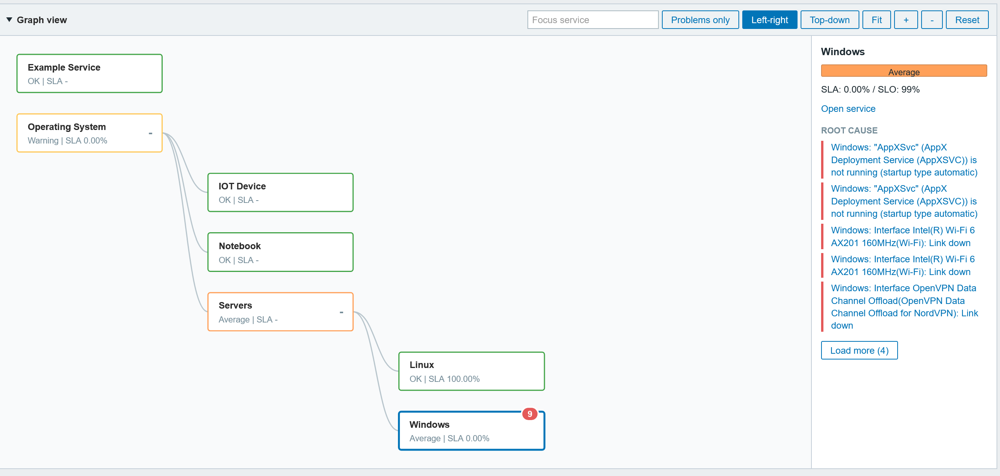

# zabbix-module-service-tree


Service Tree adds a Services tree view to Zabbix (Services -> Services tree). It renders IT Services as a parent/child tree with SLA metrics, root causes, and powerful filtering. 


## Screenshot




## Requirements
- Zabbix 7.0+ (frontend module)
- IT Services configured (Services, SLAs)

## Installation
1) Create a folder in your Zabbix server modules folder (by default `/usr/share/zabbix/`) and copy contents of this repository into folder `zabbix-module-service-tree`.
2) Go to Administration -> General -> Modules, click Scan directory and enable the module.
3) Open Services -> Services tree.

## Usage 
- Use the filter panel to search, filter by severity, and toggle columns.
- Expand/collapse branches with the arrows or the Expand all / Collapse all buttons.
- The graph starts collapsed on each page visit. Open Graph view to fetch and render it.
- Click service names to open the standard Service view.
- Click SLA names to open the SLA report.
- Export the current table view with Export CSV.

## Features
- Tree view of IT Services. Shared descendants appear once in the table; the graph retains links to their visible parents.
- Interactive SVG graph view with pan, zoom, fit-to-view, left-right/top-down layout, search focus, problem-only focus, service selection, and branch hide/show.
- Search by service name (wildcards enabled).
- Status filter (multiple severities).
- Options:
  - Only show problems
  - Show breadcrumb path
  - Only services with SLA (keeps tree structure by retaining parents)
- Column toggles:
  - SLA (%), SLO (%), SLA Name
  - Uptime, Downtime, Error Budget
  - Root cause
- Root cause list:
  - Sorted by severity
  - Links to the triggering event
  - Compact list with a ?[x more problem]? hint showing all items
- Status summary bar with counts by severity and total.
- Sorting by Name and SLA columns.
- CSV export of visible table columns (supports full breadcrumb path).
- Remembers expanded branches and filter settings via cookies.

## SLA data
- SLA metrics are fetched from the SLA configuration (SLA + Services).
- SLA percentage is shown with two decimals.
- Downtime and Error Budget use the same formatting as the SLA report.
- SLA calculations are skipped when metric columns and the graph are hidden, unless a metric is the active sort field.
- SLO and SLA Name use configuration lookups without calculating SLI. The SLA-only filter also uses configuration membership.
- Enabled SLAs are considered in name/ID order; if a service belongs to several, the first is displayed.

## Root cause data
- Root causes use Zabbix's native service problem events, including problems propagated from descendants. Event links respect event permissions.
- Root causes are available in both the table column and the graph side panel. The graph side panel shows five at a time, and graph root-cause details are lazy-loaded when a service is selected.

## Performance notes
- The initial page renders the filter and an empty container; one AJAX request loads the table.
- Collapsed descendants do not create hidden table rows or receive SLA/root-cause enrichment.
- SLA data is loaded only for displayed rows, including when sorting. Hidden descendants are sorted when expanded.
- Root cause data is loaded only when the table column or a selected graph service needs it, and only for problem services.
- The graph receives only displayed services when opened. Closing it clears SVG nodes and releases listeners and pending root-cause requests. Refreshes do not render a closed graph.
- Graph focus/search works within displayed branches; use the page filter to find services across the full hierarchy. Graph rendering is capped at 500 nodes, including focused views.
- IDs, statuses and parent IDs are still scanned to support global filters, status totals, ancestor retention and Expand all. Names are fetched only for displayed services and breadcrumb ancestors. The SLA-only filter checks membership across matching services, without calculating hidden SLI.
- Expand all explicitly requests all branches and can still be expensive on large installations.
- Add `debug=1` to the page URL to include API counters in refresh JSON responses.

See [implementation review](docs/implementation-review.md) for findings, validation and remaining limits.

## Regression checks

```sh
php tests/backend.php
node tests/frontend.cjs
# Optional integration with an installed Zabbix frontend (no database required):
php tests/render.php /usr/share/zabbix
```

## Permissions
The module uses standard Zabbix permissions for Services and Problems.

## Credits 
Credit to [Monzphere](https://monzphere.com/modulo/service-tree) for the insiration of the template. See also [this blog article](https://whatsuphome.fi/whatsuphome/part126
)

Big thanks to [@BGmot](https://github.com/BGmot) for the  [zabbix-module-hosts-tree](https://github.com/BGmot/zabbix-module-hosts-tree) module that was used as base for the development.
